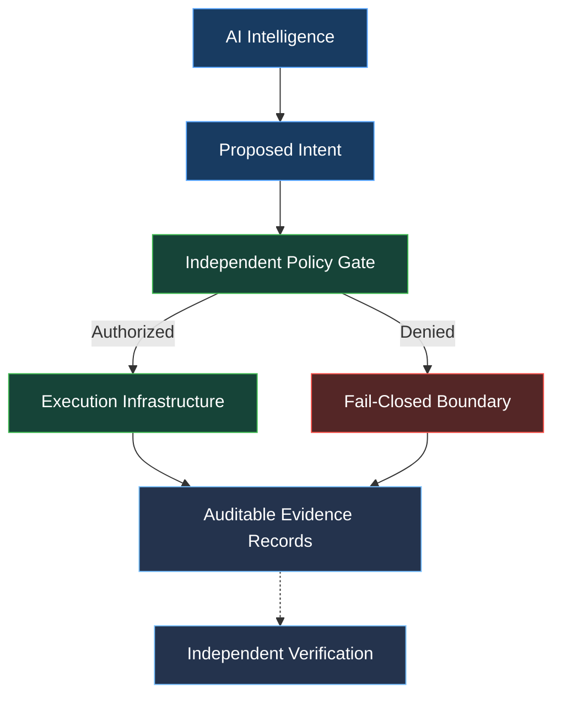
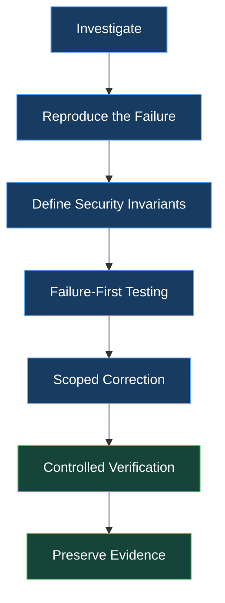

# Abdalrahman Alakhras

### Creator of Digital Qareen — Zero-Data Intent Framework

**Independent Research | AI-Assisted Engineering | Human Sovereignty**

### Designing Systems Where AI Cannot Authorize Its Own Execution.

---

[About Me](#about-me) ·
[Research](#digital-qareen) ·
[Verified Evidence](#latest-verified-research-milestone) ·
[Methodology](#engineering-methodology) ·
[Collaboration](#collaboration-and-independent-review) ·
[Contact](#contact)

---

## About Me

I am an independent creator exploring the intersection of artificial intelligence, cybersecurity, distributed systems, and execution governance through AI-assisted research and practical engineering.

I am not driven by titles, but by a deep curiosity to understand how systems work, how they fail, and how their safety boundaries can be demonstrated.

I continuously learn, challenge assumptions, reproduce failures, and develop experimental solutions.

My research is guided by a fundamental principle:

> Engineering progress should be measured by what we can demonstrate, not simply by what we can describe.

---

## Digital Qareen

### Zero-Data Intent Framework

Digital Qareen is a research initiative exploring the separation of probabilistic AI intelligence from deterministic execution authority.

The objective is to investigate how autonomous AI systems can operate within independently enforced, revocable, and auditable human authorization boundaries.

### Conceptual Architecture

*Conceptual research architecture. Independent verification and production readiness remain open.*

### Research Focus

| Research Domain | Objective |
| :--- | :--- |
| Execution Governance | Separate AI intent from execution authority |
| Deterministic Security | Enforce explicit authorization boundaries |
| Recovery Fencing | Prevent unsafe recycling of uncertain execution attempts |
| Revocation | Respect changes in authorization |
| Multi-Tenant Isolation | Preserve independent tenant boundaries |
| Idempotency | Prevent duplicate execution effects |
| Evidence Integrity | Preserve verifiable engineering records |
| Human Sovereignty | Keep execution authority under explicit human control |

---

## Latest Verified Research Milestone

### F1C — Relational Recovery Fence

**Engineering Log #07**

> A New Lease Must Never Erase Execution History.

The latest research milestone investigates how ordinary recovery mechanisms interact with unresolved historical dispatch markers.

The scoped relational recovery fence protects event claiming, authorization retry, and ordinary rescheduling.

| Verification Dimension | Local Result |
| :--- | :---: |
| Frozen security assertions | 6/6 PASS |
| Controlled multi-session concurrency scenarios | 5/5 PASS |
| Canonical migration upgrade | PASS |
| Fresh installation checksums | 24/24 PASS |
| Migration no-op rerun | PASS |
| Legitimate unmarked recovery | PASS |
| Stale-token rejection | PASS |
| Integration evidence artifacts preserved | 41 |
| Cumulative local evidence commits | 15 |
| Dedicated local evidence branches | 3 |

### Experimental Environment

- PostgreSQL 16.15
- Python
- asyncpg 0.32.0
- Isolated Docker environments
- Controlled database concurrency
- SHA-256 artifact fingerprints

### Evidence Status

**November 18, 2026**

Scoped experimental results were verified locally and preserved through dedicated Git evidence commits.

The upgrade and fresh-install paths were tested using the original migration runner.

The final evidence-sealing checkpoint verified committed artifact bytes and parentage. It did not perform an additional database execution replay.

Independent verification remains pending.

> [!IMPORTANT]
> **RESEARCH PROTOTYPE — RELEASE BLOCKED**
>
> These results do not establish production readiness, complete durable containment, or independent security certification.

---

## Engineering Methodology

My engineering workflow emphasizes:

- Explicit security invariants
- Failure-first testing
- Controlled concurrency experiments
- Isolated execution environments
- Reproducible verification
- Cryptographic artifact fingerprints
- Narrowly scoped Git commits
- Transparent documentation of failures and limitations

Failed experiments are treated as valuable research evidence rather than discarded results.

---

## Current Research Challenge

### F1D — Independent Reconciliation

**How can a system resolve an uncertain execution outcome without restoring execution authority to the component that attempted the original action?**

An unresolved execution attempt is not permission to try again.

Nor is it proof that an external action succeeded.

The next research phase investigates how independent evidence and explicitly scoped authority can support safe uncertainty resolution.

### Open Research Boundaries

- [ ] Independent reconciliation
- [ ] Durable denial admission
- [ ] Acceptance-time provider authorization
- [ ] Active integration of the verified migration candidate
- [ ] Independent verification and reproduction
- [ ] Production deployment readiness

---

## Research Roadmap

| Research Phase | Status |
| :--- | :--- |
| F1A — Authorization Propagation | Locally sealed |
| F1B — Cancellation Containment | Locally sealed |
| F1C — Relational Recovery Fence | Locally sealed |
| F1D — Independent Reconciliation | Current research |
| DQ-IV01 — Independent Verification | Preparation |
| Production Deployment | Blocked |

*Completed milestones refer to their explicitly tested and documented research scope.*

---

## Technical Focus

### Areas of Continuous Learning

- Artificial intelligence security
- Cybersecurity fundamentals
- Distributed systems
- Transactional database architecture
- Secure software engineering
- Verification infrastructure
- Agentic AI governance

---

## Collaboration and Independent Review

I welcome constructive criticism, independent verification, and research discussions with engineers and researchers working on:

- AI execution governance
- Distributed systems
- Cybersecurity
- Verification infrastructure
- Deterministic authorization
- Digital trust and human sovereignty

I am particularly interested in independent reproduction of security claims and in understanding where existing evidence is insufficient.

Technical review materials are being prepared for controlled disclosure.

I value evidence over assumptions and reproducibility over unsupported claims.

---

## Contact

| Channel | Details |
| :--- | :--- |
| LinkedIn | [Abdalrahman Alakhras](https://www.linkedin.com/in/𝐀𝐁𝐃𝐀𝐋𝐑𝐀𝐇𝐌𝐀𝐍-𝐀𝐋𝐀𝐊𝐇𝐑𝐀𝐒-5b4085420) |
| Primary Email | [cme2841991@gmail.com](mailto:cme2841991@gmail.com) |
| Alternative Email | [wesam-4-91@hotmail.com](mailto:wesam-4-91@hotmail.com) |
| Phone | +972 56 658 0000 |

Open to meaningful research discussions, technical collaboration, and independent engineering review.

---

## Engineering Philosophy

### AI Can Propose.

### Policy Must Authorize.

### Infrastructure Must Enforce.

### Evidence Must Prove.

---

*Still learning. Still building. Still questioning.*

**Digital Qareen — Zero-Data Intent Framework**

**Evidence Leads.**

